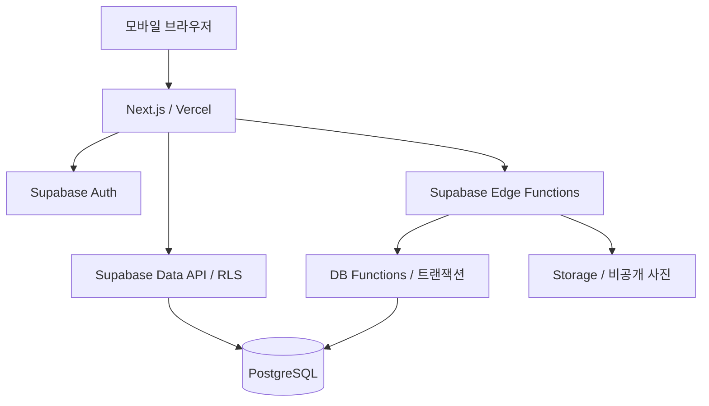

# 바이크 정비 이력 서비스 기술기획

- 작성일: 2026-10-24
- 버전: 0.1
- 기준 문서: [PRD](./PRD.md)
- 상태: 초기 구현 완료, 실제 Supabase 연결·클라우드 검증·외부 배포 전

### 초기 구현과 설계 초안의 차이

현재 구현 현황과 검증 한계는 [개발 진행 현황](./IMPLEMENTATION_STATUS.md)에 기록한다. 첫 구현은 작성 항목·사진 배치·메모를 `service_records.draft` JSONB로 일괄 저장한다. 파일 메타데이터, 공개본, 공개 사진 연결, 소유 이력, 접근 권한은 별도 테이블로 관리한다. 다음 정비 기준의 전용 날짜·주행거리 입력 및 대량 목록 페이지네이션은 후속 개선 대상으로 남아 있다. 아래 본문은 목표 설계이며 실제 구현 상태와 구분한다.

## 1. 확정 기술과 설계 범위

| 구분 | 구성 | 상태 |
|---|---|---|
| 웹 프레임워크 | Next.js + TypeScript | Next.js 확정, TypeScript 설계 기본안 |
| 웹 배포 | Vercel | 확정 |
| DB | Supabase PostgreSQL | 확정 |
| 회원 인증 | Supabase Auth | 설계 기본안 |
| 사진 저장 | Supabase Storage 비공개 버킷 | 설계 기본안 |
| 서버 업무 처리 | Supabase DB Functions(RPC) + Edge Functions | 설계 기본안 |
| 화면 구조 | Next.js App Router | 설계 기본안 |

Next.js는 화면·라우팅·인증 쿠키 연결을 담당한다. 초대 수락, 공개, 소유권 변경 등 핵심 업무 규칙은 Supabase에서 처리한다. Vercel에서 같은 업무 로직을 중복 구현하지 않는다. Next.js의 렌더링과 세션 갱신을 위한 서버 실행은 Vercel에서 수행한다.

라이브러리 버전은 구현 시작 시 공식 지원 상태를 확인해 고정하고 lockfile을 관리한다. 본 문서에서 새로 제안하는 DB·API·정책은 사용자가 확정한 제품 요구사항과 구분되는 구현 설계안이다.

## 2. 전체 구조



- 일반 데이터 조회와 정비사 임시 저장은 사용자 세션을 사용하는 Data API와 RLS로 처리한다.
- DB 내부에서 끝나는 여러 변경은 RPC 한 번의 트랜잭션으로 처리한다.
- 사진 스트리밍, 업로드 완료 검증 등 Storage 연동은 Edge Functions가 담당한다.
- Next.js 서버에서 Supabase를 호출해도 고객 조회에는 해당 고객의 세션을 사용한다.
- 고객 정보와 사진 응답은 공유 캐시·정적 페이지에 저장하지 않는다.

## 3. 인증 및 계정

- Supabase Auth의 이메일·비밀번호 인증을 사용한다.
- 이메일 인증 설정은 비활성화한다. 휴대폰 본인 확인은 사용하지 않는다.
- 가입은 초대 없이도 가능하며, 계정 생성과 차량 연결을 분리한다.
- 초대 진입 정보를 가입·로그인 과정에서 보존하고 성공 후 수락 절차로 복귀한다.
- 초대 실패 시 회원가입을 롤백하지 않는다. 계정은 유지하고 재시도 또는 안내한다.
- `@supabase/ssr`로 브라우저·서버 클라이언트를 분리한다.
- 인증 토큰 갱신은 Next.js의 해당 버전에 맞는 Proxy 등 공식 SSR 구성을 적용한다.
- 서버의 권한 판단에 검증되지 않은 클라이언트 세션 값이나 화면의 역할 표시를 사용하지 않는다.
- 고객 가입 시 관리자 권한은 생성하지 않는다.
- 정비사는 일반 가입 후 해당 Auth 사용자 ID를 운영 절차로 관리자 테이블에 등록하는 방식을 제안한다. 관리자 등록용 공개 API는 만들지 않는다.
- 비밀번호 재설정은 Supabase Auth를 사용하고, 운영용 메일 발송을 위한 외부 SMTP 제공자는 별도 결정한다. 이메일 인증을 꺼도 비밀번호 재설정 메일 발송은 필요하다.
- 임의 URL로 인증 후 이동하지 않도록 복귀 경로를 서비스 내부 허용 경로로 제한한다.

## 4. 데이터 모델

### 공통 규칙

- PK: UUID, 시간: `timestamptz`, 실제 정비 날짜: `date`.
- 정비 날짜 표시 기준은 한국 시간이다. 등록일과 정비 날짜를 구분한다.
- 이름·연락처는 고객 관리 정보이며 로그인 이메일과 별개다.
- 차량 소유 이력과 로그인 계정의 차량 접근 권한을 분리한다.
- 이메일 일치나 고객 이름·연락처 일치만으로 차량 권한을 부여하지 않는다.
- 핵심 FK, 유일성, 상태 값, 주행거리 음수 방지는 DB 제약으로 보장한다.

| 테이블 | 주요 필드·역할 |
|---|---|
| `profiles` | Auth 사용자 ID, 생성일. 고객용 계정 확장 정보 |
| `private.admin_users` | 정비사 Auth 사용자 ID. 일반 Data API에 노출하지 않음 |
| `customers` | 정비사가 등록한 이름·연락처 |
| `vehicles` | 제조사, 모델, 연식, 번호판, 차대번호, 별명 |
| `vehicle_ownerships` | 차량, 고객 관리 ID, 시작·종료 시각. 소유 이력 |
| `vehicle_access` | 소유 이력 ID, 로그인 사용자 ID. 실제 열람 연결 |
| `vehicle_invites` | 차량, 대상 소유 이력, 토큰 해시, 종류, 상태, 만료일, 수락 사용자 |
| `service_records` | 차량, 작업 당시 소유 이력, 정비 날짜, 주행거리, 작업 상태, 작성 버전 |
| `record_fields` | 정비 건, 필드 종류, 작성 내용, 공개 선택 여부 |
| `photo_groups` | 정비 건, 묶음명·설명, 순서, 공개 선택 값 |
| `photos` | 정비 건, 선택적 묶음 ID, 설명, 순서, 업로드 상태, 파일 경로, 공개 선택 값 |
| `record_notes` | 정비 건, 독립 메모, 순서, 공개 선택 여부 |
| `record_publications` | 정비 건, 대상 소유 이력, 공개 버전, 공개 시각, 고객용 스냅샷 |
| `publication_photos` | 공개본과 해당 사진 파일의 명시적 연결 |
| `vehicle_transfers` | 이전·대상 고객, 차량, 진행 상태, 검토 결과, 완료 시각 |
| `audit_events` | 초대 수락·공개·소유 변경 등의 행위자·대상·결과 |

### 관계와 제약

- 차량 하나에 활성 소유 이력은 최대 하나만 존재한다. 종료 시각이 없는 행에 부분 유일 인덱스를 적용한다.
- 한 소유 이력의 활성 고객 로그인 연결은 최대 하나를 기본안으로 한다. 한 로그인 계정은 여러 차량에 연결 가능하다.
- 고객 관리 정보는 가입 여부와 무관하게 존재한다.
- 작업 당시 고객은 소유 이력으로 보존하고, 현재 소유 고객을 변경해도 과거 작업 정보는 덮어쓰지 않는다.
- 묶음과 사진은 같은 정비 건에 속해야 한다. 복합 FK 등으로 다른 정비 건의 사진 혼입을 막는다.
- 공개 버전과 작성 버전은 서로 다르다. 공개되지 않은 변경은 작성본에만 남는다.
- 인덱스: 차량별 정비 날짜·ID, 활성 소유 이력, 계정별 차량 접근, 초대 토큰 해시, 정비 건별 사진·메모.
- 목록은 날짜와 ID를 조합한 커서 페이지네이션으로 조회한다.

## 5. 정비 기록 저장과 공개

### 작성본

- 정비사만 작성본을 조회·변경한다.
- 증상·요청, 정비 판단·원인, 작업 내용·교환 부품, 미진행 작업과 사유, 다음 정비 기준을 필드로 구분한다.
- 다음 정비 기준은 주행거리·날짜·메모를 함께 담을 수 있는 구조화 필드로 저장한다.
- 상태 기본안은 `received / inspecting / working / completed / delivered`이며 화면에 한국어로 표시한다.
- 정비 날짜와 주행거리는 정비 건의 공통 정보다. 고객에게 표시할 기본 정보의 범위는 공개 미리보기와 동일해야 한다.
- 사진·메모는 기본 비공개다. 비용 필드는 첫 버전 데이터 모델에 추가하지 않는다.

### 공개본

`publish_record(record_id, expected_revision)` RPC를 사용한다.

1. 정비사 권한과 작성 버전을 확인한다.
2. 정비 건을 잠그고 현재 저장 상태를 읽는다.
3. 공개 선택된 내용만 추출하고 스키마를 검증한다.
4. 사진은 업로드 완료된 항목만 포함한다.
5. 현재 소유 이력 대상의 고객용 스냅샷과 사진 연결을 생성한다.
6. 공개 버전과 감사 이벤트를 같은 트랜잭션으로 기록한다.

- 고객용 스냅샷은 임의의 작성본 JSON 전체를 복사하지 않고 허용 필드만 구성한다.
- 고객은 현재 소유 이력을 대상으로 공개된 최신 버전만 조회한다.
- 공개본에 선택되지 않은 필드는 응답에서 제외한다.
- 사진 설명을 수정해도 고객에게는 공개 당시 설명이 유지된다.
- 작업 상태 변경은 자동 공개를 발생시키지 않는다.
- 사용 중인 공개본이 참조하는 사진 파일은 작성본에서 제거해도 즉시 물리 삭제하지 않는다.
- 비공개 전환을 저장만 한 경우에는 기존 공개본을 유지한다. 기존 공개본을 내리는 별도 비공개 처리 정책은 추가 확정한다.

### 묶음 공개 설정 기본안

- 묶음 일괄 선택은 하위 항목의 공개 선택 값을 한 번에 변경하는 편의 기능이다.
- 이후 개별 사진·설명에서 예외 설정이 가능하다.
- 최종 노출은 각 항목의 명시적 값으로 결정한다.
- 비공개 사진의 개별 설명은 고객에게 단독 노출하지 않는다.
- 공개 사진이 없는 묶음은 고객 화면에서 숨기는 안을 제안한다.
- 고객 미리보기와 실제 공개는 동일한 변환 규칙을 사용한다. 이 조합 규칙은 제품 정책 확인 후 확정한다.

## 6. 초대와 차량 연결

- 충분히 긴 암호학적 난수 토큰을 생성하고 DB에는 해시만 저장한다.
- 링크를 안다는 사실로 연결을 허용하므로 별도 이메일·연락처 일치 검사는 하지 않는다.
- 비로그인 링크 화면은 고객 이름·연락처·정비 이력을 노출하지 않는다.
- 원문 토큰은 애플리케이션·분석 로그와 감사 이벤트에 남기지 않는다.
- 링크 화면은 외부 추적 스크립트를 사용하지 않고 referrer로 토큰이 유출되지 않도록 구성한다.
- 토큰 수락은 로그인한 사용자가 명시적인 연결 동작을 했을 때 수행한다. GET 요청이나 링크 미리보기로 소모하지 않는다.
- `accept_vehicle_invite(token)` RPC가 초대·차량 소유 행을 잠그고 유효성·사용 상태를 검사한다.
- 권한 연결 생성과 초대 사용 처리를 같은 트랜잭션으로 완료한다.
- 동일 토큰의 동시 수락은 한 번만 성공한다. 같은 계정의 재시도는 완료 결과를 반환할 수 있다.
- 기존 소유 고객과 충돌하는 연결은 일반 초대로 덮어쓰지 않고 양도 절차를 요구한다.
- 만료 기간·미사용 링크 재조회 여부·재발급 정책은 추가 확정한다. 해시만 보관하면 원문 링크 재조회는 불가능하다.

## 7. 사진 저장과 접근

- 정비 사진은 비공개 Storage 버킷에 저장한다.
- 경로는 차량·정비 건·임의 파일 ID 기반으로 만들고 이름·전화번호·번호판을 넣지 않는다.
- `photos`를 업로드 대기 상태로 먼저 만들고 저장 후 완료 검증을 수행한다.
- 파일 업로드와 DB 변경은 하나의 트랜잭션이 될 수 없으므로 대기·완료·실패 상태 및 재시도로 처리한다.
- 중복 업로드 방지용 클라이언트 작업 ID를 사용한다.
- 허용 형식·용량을 검사하고 실제 파일 형식도 확인한다. 모바일 HEIC 처리·압축·EXIF 제거·썸네일 생성 방식은 구현 전 확정한다.
- 사진과 썸네일은 원본과 동일한 권한을 적용한다.

### 고객 사진 제공 기본안

차량 양도 후 이전 차주의 새 요청을 바로 차단하려면 장기 signed URL 배포보다 **인증된 Edge Function을 통한 사진 응답**을 사용한다.

1. 고객이 로그인 세션과 공개본의 사진 식별자로 요청한다.
2. 함수가 현재 차량 접근 권한과 해당 공개본의 사진 포함 여부를 확인한다.
3. 허용되는 경우에만 비공개 파일을 읽어 반환한다.
4. 응답은 `private, no-store`로 설정하고 공유 CDN 캐시를 사용하지 않는다.

브라우저는 인증된 fetch 결과를 Blob URL로 표시한다. 고객 사진은 기본 Next.js 이미지 최적화의 공유 캐시를 통과시키지 않는다. 이미 고객이 내려받은 파일 자체를 회수하는 것은 범위 밖이다. 사진 트래픽에 따른 실행 시간·비용은 실제 사진 크기와 사용량으로 검증한다.

## 8. 차량 양도

- 새 차주용 공개본을 별도 소유 이력 대상으로 준비한다. 이전 차주 공개본을 무조건 재사용하지 않는다.
- 정비사는 기존 공개 내용을 바탕으로 새 차주에게 보일 기록을 검토하고 개인정보를 제거한다.
- 모든 과거 작업의 공개 여부를 검토한 뒤 양도용 초대를 활성화한다.
- 새 차주가 초대를 수락하는 시점에 소유권을 전환하는 안을 제안한다. 수락 전에는 이전 차주의 권한을 유지한다.
- 수락 트랜잭션에서 이전 소유 이력 종료, 이전 접근 해제, 새 소유 이력 활성화, 새 계정 연결, 검토된 공개본 활성화, 초대 사용 처리를 수행한다.
- 검토 이후 기존 공개 내용이 바뀌면 버전 충돌을 감지해 재검토를 요구한다.
- 취소·실패 시 기존 소유권을 유지한다. 동시 양도는 차량 잠금과 제약으로 막는다.
- 자유 메모·사진 속 개인정보를 자동으로 완전히 판별하지 않는다. 정비사 검토 결과를 기록한다.

## 9. 권한과 RLS

| 데이터 | 정비사 | 고객 | 비로그인 |
|---|---|---|---|
| 고객 이름·연락처 | 관리 | 직접 조회 불가 | 불가 |
| 작성 중 기록·사진·메모 | 관리 | 불가 | 불가 |
| 차량 기본 정보 | 관리 | 현재 연결 차량의 허용 필드만 | 불가 |
| 공개본·공개 사진 | 관리 | 현재 소유 연결과 대상 공개본 일치 시 열람 | 불가 |
| 초대 내부 정보 | 관리 또는 제한된 RPC | 수락 RPC만 | 토큰 검증 안내만 |
| 관리자 등록·감사 로그 | 제한된 운영 권한 | 불가 | 불가 |

- Data API 노출 테이블은 RLS를 활성화한다.
- 고객용 차량 필드는 별도 조회 RPC 또는 안전한 projection으로 제공한다. RLS는 행 단위이므로 개인정보 열을 숨기는 역할까지 맡기지 않는다.
- 관리자 권한은 DB의 보호된 테이블에서 확인한다. 사용자가 수정 가능한 메타데이터를 권한 근거로 쓰지 않는다.
- 권한 상승 RPC는 실행 권한을 명시하고 내부에서 `auth.uid()`와 역할을 확인한다.
- `SECURITY DEFINER`가 필요한 함수만 사용하고 빈 `search_path` 및 스키마 한정 이름을 적용한다.
- secret/service-role 키는 브라우저에 넣지 않는다. 사용 시 RLS 우회를 전제로 함수 내부에서 권한을 별도로 검증한다.

## 10. API와 화면 경로 초안

### Supabase RPC

| 이름 | 목적 |
|---|---|
| `create_vehicle_invite` | 관리자 초대 생성·원문 링크 최초 반환 |
| `revoke_vehicle_invite` | 미사용 초대 폐기 |
| `accept_vehicle_invite` | 일반 연결·양도 수락 트랜잭션 |
| `save_record_draft` | 작성 버전 검사 및 정비 필드 일괄 저장 |
| `preview_record_publication` | 실제 공개와 동일한 규칙으로 미리보기 |
| `publish_record` | 고객용 공개본 생성 |
| `prepare_vehicle_transfer` | 새 소유 고객·공개 이력 검토 준비 |
| `cancel_vehicle_transfer` | 미완료 양도 취소 |
| `get_my_vehicles` | 현재 연결 차량의 허용 정보 조회 |
| `get_vehicle_history` | 공개 이력 페이지 조회 |

함수 이름·인자·반환 타입은 마이그레이션 단계에서 확정한다. Edge Function은 사진 제공과 Storage 연동을 맡고, DB 원자성이 필요한 작업은 RPC에 위임한다.

### Next.js 경로

```text
/login
/signup
/forgot-password
/reset-password
/invite/[token]
/admin
/admin/customers
/admin/customers/[id]
/admin/vehicles/[id]
/admin/records/[id]
/admin/records/[id]/preview
/admin/vehicles/[id]/transfer
/my/vehicles
/my/vehicles/[id]
/my/records/[id]
```

## 11. 저장 안정성과 충돌 처리

### 반응형 UI 구현 기준

- 모바일 전용 앱이 아닌 모바일·태블릿·데스크톱 공통 반응형 웹으로 구현한다.
- 정비사·고객 화면 모두 동일한 데이터와 권한 규칙을 사용하고 기기별로 주요 기능을 제한하지 않는다.
- 모바일 우선 CSS를 기본으로 하되 넓은 화면에서는 다중 열, 목록·상세 배치, 사진 그리드를 적용한다.
- 화면 분기점은 콘텐츠에 맞춰 정한다. 검증 대표 너비는 360px, 390px, 768px, 1024px, 1440px로 두고 중간 너비에서도 확인한다.
- 모바일 카메라 촬영과 일반 파일 선택을 함께 지원한다. 데스크톱에서 카메라가 없어도 사진을 등록할 수 있다.
- 터치·마우스·키보드 조작, 포커스 표시, 화면 확대 시 입력과 탐색 가능 여부를 확인한다.
- 공개 미리보기는 고객의 모바일·데스크톱 배치를 모두 확인할 수 있게 설계한다.
- 목록·폼·모달·사진 묶음에 불필요한 페이지 가로 스크롤이나 요소 겹침이 생기지 않도록 한다.

### 저장과 동시 수정

- 자동 저장에는 작성 버전을 보내며 충돌 시 조용히 덮어쓰지 않는다.
- 사진 업로드 대기와 폼 저장 상태를 구분해 표시한다.
- 미완료 업로드가 있으면 이를 알리고 해당 사진의 공개를 막는다.
- 초대 수락·공개·양도는 재시도와 동시 요청에서 중복 결과가 생기지 않게 처리한다.
- 여러 기기에서 같은 정비 건을 수정하는 경우 충돌을 안내한다.
- 완전한 오프라인 사용은 이번 범위에 포함하지 않는다. 연결 실패 시 저장 실패와 재시도 상태를 제공한다.

## 12. 프로젝트 구조와 배포

```text
app/                    # 화면, 레이아웃, 인증 콜백
components/             # 공통 UI
features/               # 차량·정비 기록·공개·양도별 화면 로직
lib/supabase/           # 브라우저·서버 클라이언트
lib/validation/         # 입력·공개본 스키마
supabase/migrations/    # 테이블·RLS·RPC 변경 이력
supabase/functions/     # Edge Functions
tests/                  # 권한·트랜잭션·핵심 사용자 흐름
```

- 개발·운영 Supabase 프로젝트와 환경 변수를 분리한다.
- Vercel Preview가 운영 DB에 접근하지 않게 한다.
- 로컬 Supabase CLI로 DB 마이그레이션과 권한 테스트를 재현한다.
- DB 변경은 SQL 마이그레이션으로 관리하고 운영 수동 변경을 기준으로 삼지 않는다.
- Vercel에는 앱 URL과 Supabase URL·공개 키 등 필요한 환경 변수만 둔다.
- privileged 키는 해당 작업이 실제 필요한 서버 환경에만 둔다. 공개 환경 변수 접두사를 붙이지 않는다.
- 운영 앱 도메인과 로컬 개발 주소를 Auth의 허용 리다이렉트에 설정한다.
- UI만 되돌려도 DB가 호환되도록 추가→데이터 이관→구버전 제거 순서로 변경한다.
- DB 백업과 Storage 파일 백업을 별도로 계획한다. 보관 기간과 복구 목표는 추가 결정한다.
- Edge Functions·Next.js·DB 오류를 구분해 수집하고, 토큰·비밀번호·메모 원문은 로그에 남기지 않는다.
- 한국 사용자 기준 Supabase 리전과 Vercel 실행 리전을 가깝게 배치하는 것을 기본안으로 한다. 실제 선택 가능 리전·요금제는 프로젝트 생성 때 확인한다.

## 13. 검증과 구현 순서

### 반드시 검증할 흐름

1. 고객 A가 고객 B의 차량·기록·사진에 직접 요청해도 접근 불가.
2. 고객이 공개본을 조회해도 비공개 필드와 작성 중 변경이 응답에 포함되지 않음.
3. 같은 초대를 동시에 수락하면 한 계정만 연결됨.
4. 초대 없는 가입 후에도 이후 링크로 연결 가능.
5. 공개 전 사진·설명 수정은 고객에게 반영되지 않음.
6. 양도 완료 후 이전 차주의 데이터·사진 새 요청이 거부됨.
7. 새 차주는 개인정보 검토된 공개본만 조회함.
8. 사진 업로드 실패와 재시도에서 중복·공개 누락을 감지함.
9. 과거 기록이 정비 날짜 기준으로 정렬됨.
10. 일반 가입자가 관리자 역할이나 소유 연결을 직접 변경할 수 없음.
11. 모바일·태블릿·데스크톱 대표 너비에서 가입·초대 연결·정비 작성·사진 업로드·공개·고객 열람·양도 흐름을 완료할 수 있음.
12. 데스크톱 키보드·마우스와 모바일 터치에서 주요 조작이 가능하고 화면 잘림·겹침·불필요한 가로 스크롤이 없음.

### 구현 단계

1. DB 스키마·소유 관계·공개본 구조·RLS 설계 및 테스트
2. 가입·로그인·관리자 초기 설정·차량 초대 연결
3. 고객·차량 관리 및 사진 먼저 저장하는 정비 화면
4. 사진 묶음·작성본 저장·공개 미리보기·공개본 생성
5. 고객 차량 목록·이력·권한 적용 사진 열람
6. 과거 이력 및 차량 양도
7. 운영 설정·모바일 확인·Vercel/Supabase 배포

## 14. 다음 확정 항목

- 최초 관리자 계정 이메일과 생성 절차
- 비밀번호 최소 정책과 복구 메일용 SMTP 제공자
- 초대 만료 기간
- 차량 양도의 최종 확정 시점
- 사진 형식·크기·개수 제한 및 HEIC 변환
- 데이터 필수 입력 항목과 기록 삭제·공개 취소 정책
- 예상 차량·사진 수와 요금제·리전·백업

## 15. 확인한 공식 문서

- [Next.js 배포](https://nextjs.org/docs/pages/getting-started/deploying)
- [Supabase Next.js SSR 클라이언트](https://supabase.com/docs/guides/auth/server-side/creating-a-client)
- [Supabase 이메일 인증 설정](https://supabase.com/docs/guides/auth/general-configuration)
- [Supabase 운영용 SMTP](https://supabase.com/docs/guides/auth/auth-smtp)
- [Supabase RLS](https://supabase.com/docs/guides/database/postgres/row-level-security)
- [Supabase DB Functions](https://supabase.com/docs/guides/database/functions)
- [Supabase Storage 접근 제어](https://supabase.com/docs/guides/storage/security/access-control)
- [Supabase 비공개 파일 제공과 signed URL](https://supabase.com/docs/guides/storage/serving/downloads)

공식 문서는 2026-10-24 기준으로 확인했다. 실제 구현 시 사용하는 SDK 버전과 배포 설정에 맞춰 재확인한다.
